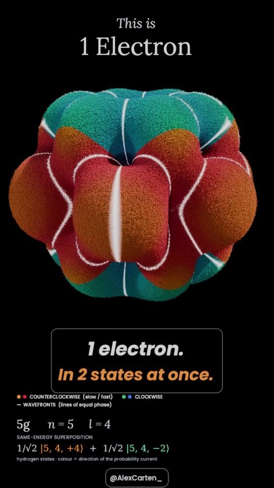
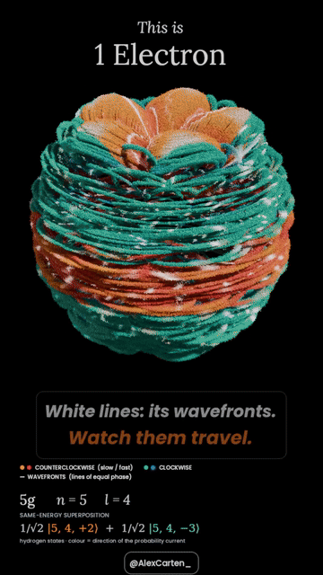
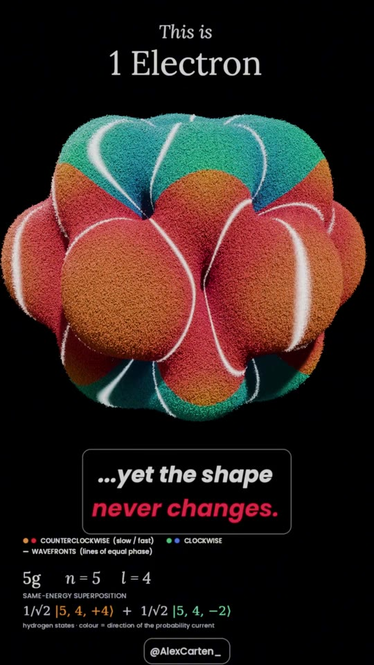
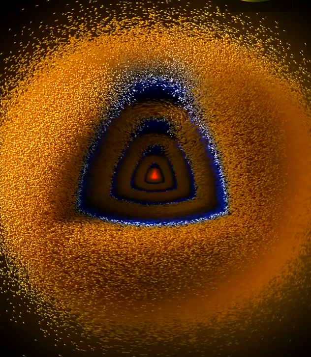
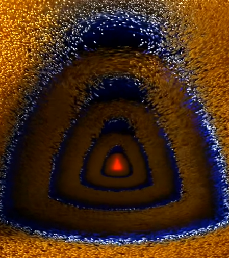

# quantum-flow

Hydrogen atom simulations: real orbitals, with the **probability current** shown as millions of flowing particles.


*Reference: original visualization by Anssi Kuha ([Imagining Physics](https://www.youtube.com/@imaginingPhysics)).*

Made by **[@AlexCarten_](https://x.com/AlexCarten_)**. Videos from this repo are posted on X.

## What you are looking at

An electron in an atom is not a dot on a circle. It is a cloud described by a wavefunction ψ. The cloud is never still: probability flows through it, and that flow follows from the Schrödinger/Pauli equation with electron spin included.

- **Orange**: flowing counterclockwise (viewed from +z)
- **Blue**: flowing clockwise
- **White**: slow
- **Red**: the hot core next to the nucleus

Velocity field used everywhere (atomic units, spin up):

```
v = Im(∇ψ / ψ) + ½ ∇ × (ρ ẑ) / ρ        ρ = |ψ|²
```

For a stationary orbital ψₙₗₘ this is pure rotation around z:  `v_φ = m/s − ½ ∂ln ρ/∂s`.

## New: 1 electron, 2 states at once

<p align="center">
  
  &nbsp;
  
  &nbsp;
  
</p>

<p align="center"><i>Watch it on X: <a href="https://x.com/AlexCarten_">@AlexCarten_</a></i></p>

**Script:** [`blender/one_electron_blender.py`](blender/one_electron_blender.py) · **Music:** [`media/one_electron_music.wav`](media/one_electron_music.wav) (same 30 s timing)

A single hydrogen electron placed in an equal mix of 2 states with the **same energy** (same n and l, different m):

```
ψ = ( |n, l, m₁⟩ + |n, l, m₂⟩ ) / √2        e.g.  n = 5, l = 4, m = +4 and −2
```

Because both states share one energy, |ψ|² does not change in time: **the shape is frozen forever**.
Yet the probability current `j = ρ ∇(phase)` is not zero, so **something keeps flowing through it**.
The round cloud of a single orbital breaks into lobes with (m₁ − m₂)-fold symmetry.

How it is drawn:

| On screen | Meaning |
|---|---|
| Grains on a surface | iso-surface of \|ψ\|²: where the electron is most likely to be found |
| Orange · red | current circulating counterclockwise around z (slow → fast) |
| Green · blue | current circulating clockwise (slow → fast) |
| White lines | wavefronts (lines of equal phase); they travel as the global phase e^(−iEt) turns |
| Round hole (optional, `CUT`) | the top is cut away to show the cross-section through the middle |

Four shapes morph into each other: 3d, 4f, 5g and 5g. Spin is left out here (plain Schrödinger current), and each shape is scaled to fit the frame.

**Run it:** Blender 4.2+ / 5.x → File › New › General → Scripting → Open `one_electron_blender.py` → Run Script (about 1 minute to build the 4 shapes) → Render › Render Animation.
Settings at the top of the file: `N_TOTAL` (grains), `FPS` (30 or 60), `STATES`, `KAPPA` (rounder ↔ more lobes), `CUT`, `HOLE_R`, `SHIMMER`.

There is a cat hidden in the video.

## Three tools

| Folder | What it is | Quality | Speed |
|---|---|---|---|
| [`blender/`](blender) | Blender 5.x script: millions of lit particles, real shadows, motion blur, camera fly-in | best | slow (GPU, minutes per second of video) |
| [`studio/`](studio) | Orbital Studio: runs in the browser on your GPU, exports MP4 | good | fast |
| [`python/`](python) | Pure numpy renderers, incl. the **2p → 1s light emission** (superposition + Bohmian flow) | good | medium (CPU) |

### Blender
1. Install Blender 5.2 LTS.
2. Scripting tab → Open `blender/orbital_blender.py` → Run Script.
3. Render → Render Animation. The MP4 lands in `~/OrbitalRenders`.

Edit the CONFIG block at the top: `STATE = (n, l, m)`, particle count, camera angle, cutaway, fly-in.



### Orbital Studio (browser)
Open `studio/index.html` in desktop Chrome or Edge. Pick a preset, press **Render MP4**.
Live version: enable GitHub Pages for this repo and open `https://<your-name>.github.io/quantum-flow/studio/`.



### Python
```
pip install numpy scipy pillow
python python/emit3d.py out.mp4          # 2p → 1s emission, 38 s, 1080x1920 (needs ffmpeg)
python python/orbitals.py out.mp4 7      # tour of stationary orbitals
```
`emit3d.py` imports `emission.py` and `emit_video.py`, keep them in the same folder.

## Physics notes
- Orbitals are exact hydrogen eigenfunctions: Laguerre radial part × associated Legendre angular part × e^{imφ}.
- Particles are sampled from |ψ|² and move with the Pauli current, so the distribution stays correct as they flow.
- In the emission video the electron is in a superposition c₁·1s + c₂·2p(m=−1). The lopsided cloud rotates at ΔE/ħ (10.2 eV, the Lyman-α line at 121.6 nm) and the amplitude slowly moves from 2p to 1s. The light rings are a visual of the emitted dipole radiation, not a field solution.

Inspired by the work of Anssi Kuha ([Imagining Physics](https://www.youtube.com/@imaginingPhysics)), who showed this kind of probability-flow visualization first. All code here is written from scratch.

## License
Code: MIT. Videos and images in `media/`: © Alex Carten, credit @AlexCarten_ when you repost.
The Caveat font in `python/fonts` is under the SIL Open Font License.
