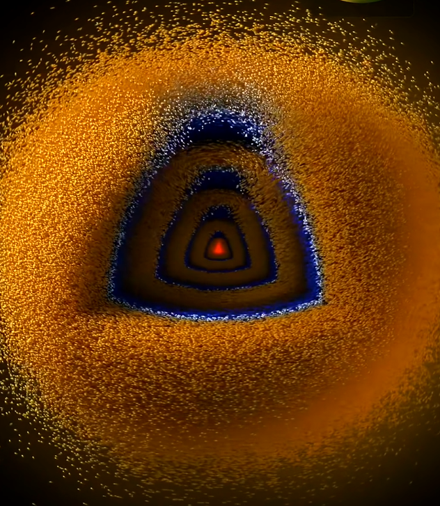
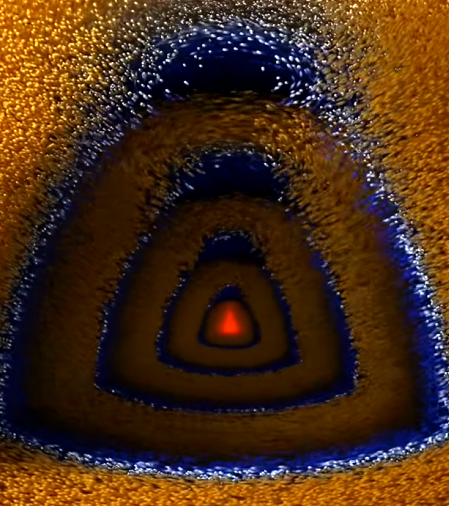

# quantum-flow

Hydrogen atom simulations: real orbitals, with the **probability current** shown as millions of flowing particles.


Made by **[@AlexCarten_](https://x.com/AlexCarten_)**. Videos from this repo are posted on X.

## What you are looking at

An electron in an atom is not a dot on a circle. It is a cloud described by a wavefunction ψ. The cloud is never still: probability flows through it, and that flow follows from the Schrödinger/Pauli equation with electron spin included.

- **Orange**: flowing counterclockwise (viewed from +z)
- **Blue**: flowing clockwise
- **White**: slow
- **Red**: the hot core next to the nucleus

Velocity field used everywhere (atomic units, spin up):

```
v = Im(∇ψ / ψ) + ½ ∇ × (ρ ẑ) / ρ        ρ = |ψ|²
```

For a stationary orbital ψₙₗₘ this is pure rotation around z:  `v_φ = m/s − ½ ∂ln ρ/∂s`.

## Three tools

| Folder | What it is | Quality | Speed |
|---|---|---|---|
| [`blender/`](blender) | Blender 5.x script: millions of lit particles, real shadows, motion blur, camera fly-in | best | slow (GPU, minutes per second of video) |
| [`studio/`](studio) | Orbital Studio: runs in the browser on your GPU, exports MP4 | good | fast |
| [`python/`](python) | Pure numpy renderers, incl. the **2p → 1s light emission** (superposition + Bohmian flow) | good | medium (CPU) |

### Blender
1. Install Blender 5.2 LTS.
2. Scripting tab → Open `blender/orbital_blender.py` → Run Script.
3. Render → Render Animation. The MP4 lands in `~/OrbitalRenders`.

Edit the CONFIG block at the top: `STATE = (n, l, m)`, particle count, camera angle, cutaway, fly-in.



### Orbital Studio (browser)
Open `studio/index.html` in desktop Chrome or Edge. Pick a preset, press **Render MP4**.
Live version: enable GitHub Pages for this repo and open `https://<your-name>.github.io/quantum-flow/studio/`.



### Python
```
pip install numpy scipy pillow
python python/emit3d.py out.mp4          # 2p → 1s emission, 38 s, 1080x1920 (needs ffmpeg)
python python/orbitals.py out.mp4 7      # tour of stationary orbitals
```
`emit3d.py` imports `emission.py` and `emit_video.py`, keep them in the same folder.

## Physics notes
- Orbitals are exact hydrogen eigenfunctions: Laguerre radial part × associated Legendre angular part × e^{imφ}.
- Particles are sampled from |ψ|² and move with the Pauli current, so the distribution stays correct as they flow.
- In the emission video the electron is in a superposition c₁·1s + c₂·2p(m=−1). The lopsided cloud rotates at ΔE/ħ (10.2 eV, the Lyman-α line at 121.6 nm) and the amplitude slowly moves from 2p to 1s. The light rings are a visual of the emitted dipole radiation, not a field solution.

Inspired by the work of Anssi Kuha ([Imagining Physics](https://www.youtube.com/@imaginingPhysics)), who showed this kind of probability-flow visualization first. All code here is written from scratch.

## License
Code: MIT. Videos and images in `media/`: © Alex Carten, credit @AlexCarten_ when you repost.
The Caveat font in `python/fonts` is under the SIL Open Font License.
